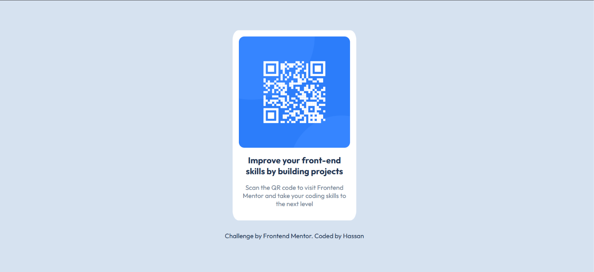
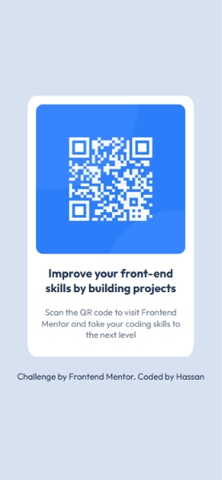

# Frontend Mentor - QR code component solution

This is a solution to the [QR code component challenge on Frontend Mentor](https://www.frontendmentor.io/challenges/qr-code-component-iux_sIO_H). Frontend Mentor challenges help you improve your coding skills by building realistic projects.

## Overview

This project is a solution to the **QR code component challenge** on Frontend Mentor. The main objective is to build a clean, responsive, and pixel-perfect card component using fundamental web technologies to strengthen my front-end development skills.

### Screenshot

- 
- 

### Links

- Solution URL: [solution URL](https://www.frontendmentor.io/solutions/qr-code-component-using-css-grid-and-semantic-html5-elements-yi3z3HvLHQ)
- Live Site URL: [Live Site URL](https://hamdouch-09.github.io/QR-code-component/)

## My process

- **Semantic HTML5:** I used semantic HTML5 elements to build a meaningful page structure. Specifically, I used the `<figure>` element to house the QR code image and its associated caption/content instead of relying on generic `<div>` tags.
- **Layout & Centering:** I used CSS Grid to neatly layout and center the card perfectly in the middle of the page.
- **Desktop-First Workflow:** I adopted a desktop-first approach, building and styling the layout for larger screens initially, and then adapting it for smaller mobile screens.

### Built with

- Semantic HTML5 markup
- CSS Grid
- Desktop first workflow
- CSS custom properties

## What I learned

- **Semantic HTML & Structure:** I learned how to structure a page correctly by using semantic elements like `<main>`, `<figure>`, and `<figcaption>` instead of relying solely on generic `<div>` tags, which greatly improves accessibility and code readability.

```html
<div class="page">
  <!--main content -->
  <main class="container">
    <figure class="qr-code-component">
      
      <figcaption class="qr-code-caption">
        <h1>Improve your front-end skills by building projects</h1>
        <p>
          Scan the QR code to visit Frontend Mentor and take your coding skills
          to the next level
        </p>
      </figcaption>
    </figure>
  </main>
</div>
```

- **CSS Grid & Centering:** I used CSS Grid with `place-items: center` on the
  `body` (with a `min-height: 100vh`) to easily and perfectly center the card in
  the middle of the viewport.

```css
body {
  min-height: 100vh;
  background-color: var(--main-color);
  display: grid;
  place-items: center;
}
```

- - **Relative Units (`rem`):** Utilized `rem` units for padding and sizing to ensure a proportional, scalable layout that gracefully adapts to different font sizes.

```css
.container .qr-code-component {
  background-color: var(--card-color);
  width: 18rem;
  height: 100%;
  padding: 0.9rem;
  border-radius: 5%;
  display: grid;
  justify-content: center;
}
```

### Continued development

- Aim to improve the responsiveness of this design in the future.
- Test the component across different screen sizes.
- Test different fonts.
- Translate the README file.

### Useful resources

- [Elzero Web School](https://elzero.org/tracks/front-end/) - This platform and its free courses, along with practical assignments after each lesson, have helped me tremendously in my learning journey. It is where I learned the most important fundamentals of web development.

### AI Collaboration

- **GitHub Copilot & VS Code:** Used lightly for final code checks and syntax best practices after writing the code myself.
- **Google Gemini:** Used to assist with structuring the `README.md` file, handling translations, and improving text formatting.

## Author

- Frontend Mentor - [@Hamdouch-09](https://www.frontendmentor.io/profile/Hamdouch-09)
- Twitter - [@Hmadouch_09](https://x.com/Hmadouch_09)

## Acknowledgments

- **Frontend Mentor:** A sincere thank you to the team for providing these amazing challenges that greatly help us improve our front-end development skills.
  [Frontend Mentor](https://www.frontendmentor.io).
- **Elzero Web School:** A special thanks to Osama Elzero, who has been the primary and official supporter throughout my learning journey in web development.
  [Elzero Web School](https://elzero.org/tracks/front-end/).
